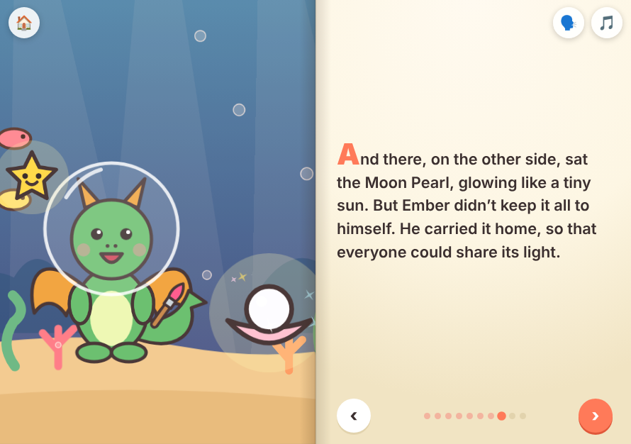
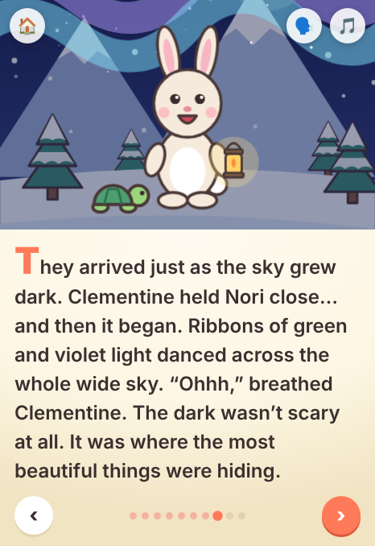

# Twinkle Tales

An animated children's storybook. Answer seven quick questions (hero, name, place, companion, magic item,
what the story is about, bedtime or adventure) and the app writes a ten-page picture book with animated
illustrations, music, sound effects and read-aloud narration.

Laid out for the iPhone Duo:

| Unfolded: a two-page spread, spine on the crease | Folded: one page, picture over words |
| --- | --- |
|  |  |

## Run it

No build step and no dependencies; it is a static site.

```sh
python3 -m http.server 8000   # then open http://localhost:8000
```

## Install on the phone

The repo deploys itself to GitHub Pages on every push to `main` (`.github/workflows/pages.yml`).

1. One-time: in the repo, go to Settings → Pages and set **Source** to **GitHub Actions**.
2. Push to `main` (or run the "Deploy to GitHub Pages" workflow from the Actions tab).
3. On the phone, open `https://rhoadsjustin.github.io/storybook/` in Safari and choose Share → Add to Home Screen.

It then runs full screen and works offline.

## How it works

Everything is generated on the device. There are no API keys, network calls or media files.

| File | Job |
| --- | --- |
| `js/story.js` | Story engine: builds the title and page text from the answers, and describes each page's picture |
| `js/scenes.js` | Draws every illustration as animated SVG (heroes, companions, four worlds, props) |
| `js/audio.js` | Web Audio synth for music, ambience and effects; narration via the built-in speech voice |
| `js/app.js` | Screens, questions, page turning, bookshelf (saved in `localStorage`) |
| `css/style.css` | Layout for folded and unfolded, page-turn and picture animations |
| `sw.js` | Offline cache |

Things to try while reading: tap the hero, the companion, the sun or the fish; swipe to turn pages; tap the
words to hear them again.

## Fold layout

The spread layout switches on at `min-width: 600px` with a landscape-ish aspect ratio, which covers the Duo's
unfolded screen (about 890×626 CSS px) while the folded screen (about 466×678) gets the single page. Where a
browser exposes the Viewport Segments API (`horizontal-viewport-segments: 2`), the two pages are sized to the
two screen halves exactly; otherwise the spine is centred.
